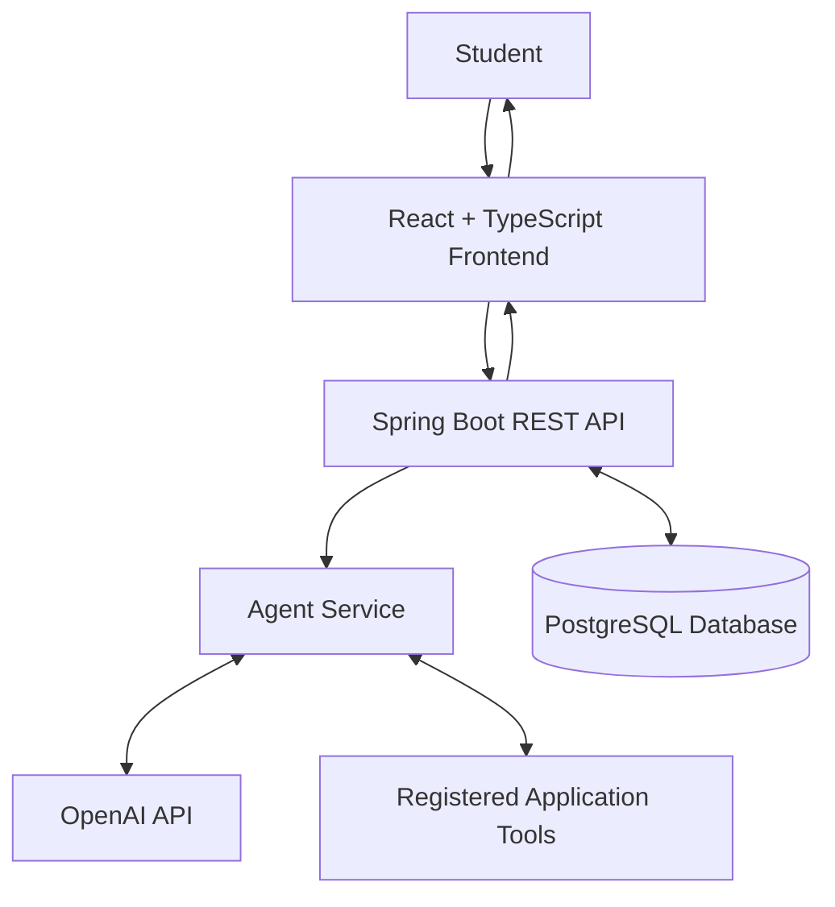

# 🤖 AI Study Planner Agent

<p align="center">
  
</p>

<p align="center">
  An AI-powered study planning application that helps students organize their syllabus, manage deadlines, and create personalized study schedules.
</p>

<p align="center">
  
  
  
  
  
</p>

---

## 📌 About the Project

The **AI Study Planner Agent** is a full-stack application designed to make academic planning easier and more organized.

Students often struggle to divide large syllabuses into manageable topics, estimate study time, balance multiple subjects, and prepare for exams without last-minute pressure.

This project explores how an AI-powered workflow can help students organize their learning and create study plans around their individual deadlines and available time.

### 🎯 Project Objectives

- Transform syllabus content into manageable study topics.
- Organize study activities around deadlines and available time.
- Generate structured study plans based on planning preferences.
- Support a more organized approach to exam preparation.
- Demonstrate the integration of AI, backend services, and a modern web interface.

## ✨ Key Features

### 📚 Syllabus Organization
- Break syllabus content into smaller study topics.
- Organize related topics into learning units.
- Make large amounts of academic content easier to manage.

### 🧠 Personalized Study Planning
- Organize study activities around deadlines.
- Account for available study time and planning preferences.
- Distribute study tasks across a structured schedule.

### 📅 Schedule Management
- Review planned study activities.
- Adjust planning information as requirements change.
- Keep study-planning information organized.

### 🤖 AI Integration
- Integrate a language model through the OpenAI API.
- Use function calling to connect supported AI workflows with application tools.
- Coordinate AI-related operations through the Spring Boot backend.

*Feature availability depends on the implemented application version and its configuration.*

## 🏗️ System Architecture

The application follows a full-stack architecture:



### How It Works

1. The student enters syllabus information and planning preferences.
2. The frontend sends requests to the Spring Boot backend.
3. The backend coordinates the relevant application services.
4. The AI workflow can request supported tools through function calling.
5. Application services process requests and interact with the database.
6. The frontend displays the resulting information.

## 🛠️ Technology Stack

| Technology | Purpose |
|---|---|
| Java 21 | Backend programming |
| Spring Boot | REST APIs and backend services |
| React | Frontend user interface |
| TypeScript | Type-safe frontend development |
| PostgreSQL | Relational database |
| OpenAI API | Language-model integration |
| OpenAI Function Calling | Structured tool requests |
| Maven | Backend build and dependency management |
| npm | Frontend package management |
| Git and GitHub | Version control |

## 📂 Project Structure

```text
ai-study-planner-agent/
├── backend/
│   ├── src/
│   │   ├── main/
│   │   └── test/
│   └── pom.xml
├── frontend/
│   ├── src/
│   └── package.json
├── docs/
├── scripts/
├── .env.example
├── .gitignore
└── README.md
```

*The structure above is representative; the actual files in the repository determine the final project layout.*

## 🚀 Getting Started

### Prerequisites

Install the following tools:

- Java 21
- Maven
- Node.js and npm
- PostgreSQL
- Git

An OpenAI API key is required for model-backed functionality when enabled.

### 1. Clone the Repository

```bash
git clone https://github.com/bvssusank/ai-study-planner-agent.git
cd ai-study-planner-agent
```

### 2. Configure Environment Variables

Review the `.env.example` file and configure the environment variables required by the application.

Example configuration:

```text
DATABASE_URL=jdbc:postgresql://localhost:5432/study_planner
DATABASE_USERNAME=your_database_username
DATABASE_PASSWORD=your_database_password
OPENAI_API_KEY=your_openai_api_key
OPENAI_MODEL=gpt-4o-mini
APP_ORIGIN=http://localhost:5173
```

Use the actual variable names expected by the backend configuration. The values above are examples, not production credentials.

**Never commit real API keys, passwords, or other secrets to GitHub.**

### 3. Prepare PostgreSQL

1. Start PostgreSQL.
2. Create the database required by the application.
3. Configure the database credentials in your environment.
4. Check the backend configuration for any additional database settings.

### 4. Run the Backend

Open a terminal in the project directory:

```powershell
cd backend
mvn spring-boot:run
```

Configure the required environment variables before starting the backend.

The local backend is expected to run at:

```text
http://localhost:8080
```

### 5. Run the Frontend

Open a second terminal in the project directory:

```powershell
cd frontend
npm install
npm run dev
```

Open the local URL printed by Vite, normally:

```text
http://localhost:5173
```

Follow the actual project configuration if the frontend or backend uses different ports or startup commands.

## 🔐 Security

- Keep API keys and database passwords private.
- Do not commit local `.env` files containing secrets.
- Use environment variables for sensitive configuration.
- Review authentication and authorization before public deployment.
- Use secure configuration for production databases and external APIs.

## 🧪 Testing

Run backend tests from the `backend` directory:

```bash
mvn test
```

Run frontend tests using the scripts available in `frontend/package.json`.

Verify the application's database connection, API endpoints, and AI integration in your local environment.

## 🌱 Future Improvements

Potential improvements include:

- Adaptive schedules based on study progress.
- Better revision planning and missed-session recovery.
- Clearer explanations of generated study plans.
- Improved visibility into AI tool calls.
- Additional testing and evaluation of AI-generated outputs.
- Production deployment and monitoring.

## 🎓 Learning Outcomes

This project demonstrates practical concepts in:

- Full-stack application development.
- Java and Spring Boot backend engineering.
- React and TypeScript frontend development.
- PostgreSQL database integration.
- AI integration and function calling.
- REST API design and application architecture.
- Environment configuration and Git-based collaboration.

## 👨‍💻 Author

**bvssusank**

GitHub: [@bvssusank](https://github.com/bvssusank)

---

<p align="center">
  <b>Plan smarter. Learn consistently. Achieve more. 🚀</b>
</p>
